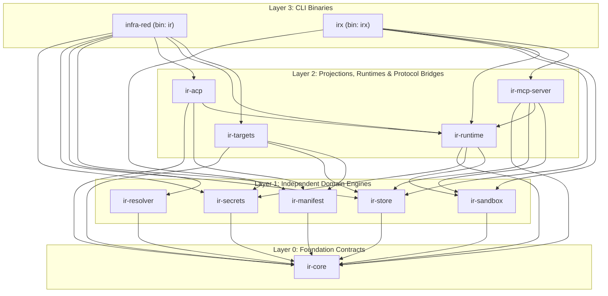

# Infra-Red System Architecture

## 1. Core Architectural Invariants

1. **Strictly Acyclic 4-Layer Workspace**:
   - **Layer 0 (`ir-core`)**: Zero internal dependencies. Defines domain structs, `IrError`, the 6 trait seams, and `ir_core::testing` mocks.
   - **Layer 1 (`ir-manifest`, `ir-resolver`, `ir-store`, `ir-secrets`, `ir-sandbox`)**: Depend **only** on `ir-core`. Can be developed and unit-tested 100% in parallel.
   - **Layer 2 (`ir-targets`, `ir-runtime`, `ir-mcp-server`, `ir-acp`)**: Compose Layer 1 crates behind `ir-core` trait objects (`Arc<dyn ...>`).
   - **Layer 3 (`infra-red`, `irx`)**: Thin CLI entrypoints parsing flags via `clap` and wiring concrete implementations.
2. **Zero Plaintext Secrets on Disk**:
   - `infra-red.toml` only ever stores logical secret references (e.g., `GITHUB_TOKEN = "github/payments-pat"`).
   - Secrets are resolved in memory wrapped in `zeroize::Zeroizing<String>` and delivered either via the `ir exec-mcp` stdio trampoline (Tier 1) or the loopback secret-swapping proxy (Tier 2).
3. **Never Silently Clobber User Edits or Run Untrusted Hooks**:
   - Target config files emitted by `ir sync` are SHA-256 hashed into `.infrared/state/target-hashes.json`; hand-edited files require `--force`.
   - Lifecycle hooks and arbitrary stdio commands in cloned repositories remain quarantined until explicitly approved via `ir trust`.

## 2. Crate Dependency Graph

## 3. The Six Extensibility Trait Seams (`crates/ir-core/src/traits.rs`)

| Seam | Trait | Purpose |
| :---: | :--- | :--- |
| 1 | `ArtifactSource` | Pluggable artifact fetchers (`registry:`, `git:`, `npm:`, `local:`) into the global CAS. |
| 2 | `TargetAdapter` | Declarative config projection and drift reconciliation per IDE / coding agent CLI. |
| 3 | `AgentRuntime` | Isolated `.infrared/` env construction (`CLAUDE_CONFIG_DIR`, `CODEX_HOME`, `agy`) and headless command builders. |
| 4 | `SandboxBackend` | OS-native confinement (`bwrap`+`seccomp`, `/usr/bin/sandbox-exec`, Windows Job Objects, opt-in OCI) + `process-wrap` reaping. |
| 5 | `SecretProvider` | Zero-disk-leak credential retrieval (OS keyring, CI env, external vaults). |
| 6 | `ProtocolBridge` | Protocol servers/proxies (MCP `2026-07-28`, ACP v1/v2, future A2A v1 / AG-UI). |

## 4. Target Projection Matrix (`ir-targets`)

| Target | MCP Config Path & Key | Skills / Plugins Path | Platform Caveat Handled Automatically |
| :--- | :--- | :--- | :--- |
| **Claude Code** | `.mcp.json` (`mcpServers`) | `.claude/skills/<name>/SKILL.md` | Isolates `~/.claude.json` via `CLAUDE_CONFIG_DIR`, passes `--strict-mcp-config`. |
| **OpenAI Codex** | `.codex/config.toml` (`[mcp_servers.<name>]`) | `AGENTS.md` pointers | Relocates via `CODEX_HOME`; wraps stdio MCP servers in sandbox. |
| **Google Antigravity** | `.agents/mcp_config.json` | `.agents/plugins/<name>/`, `.agents/hooks.json` | Never mixes `--sandbox` with `--dangerously-skip-permissions`. |
| **VS Code / Copilot** | `.vscode/mcp.json` (**`servers`** key) | `.github/skills/<name>/SKILL.md` | **Must use `CowOrHardlink` (never symlinks)**; rewrites secret servers to `ir exec-mcp`. |
| **Cursor** | `.cursor/mcp.json` (`mcpServers`) | `.cursor/skills/<name>/SKILL.md` | Deduplicates via CAS links; warns on unsupported Claude-only hooks. |
| **Zed & JetBrains** | Dynamic per ACP `session/new` | `settings.json` / `~/.jetbrains/acp.json` | **Writes absolute binary paths** for JetBrains (no login shell). |
